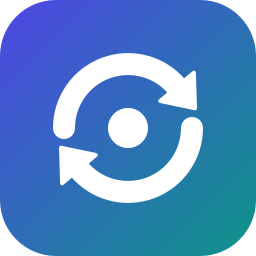

# AI Handoff MCP

**Your AI coding agent hits its usage limit mid-task. The next agent, from any vendor, continues from the exact stopping point, without a model call, without reading old sessions and without re-exploring the code.**

Local-first MCP server + host hooks for Claude Code, VS Code (Copilot), Copilot CLI, Cursor, Gemini CLI, Windsurf / Devin Desktop and Visual Studio. No network, no telemetry, and session transcripts are never read. Two guards protect the same credits: a prompt gate and a loop guard, both running outside the model.

> In Arabic: a practical usage guide, [USAGE.ar.md](USAGE.ar.md), and the full guide, [DOCUMENTATION.ar.md](DOCUMENTATION.ar.md)

## Measured, not claimed

Every number below comes from [BENCHMARK.md](BENCHMARK.md) (`npm run bench`, no model, no network; tokens estimated at 3.5 characters per token).

| | Result |
|---|---|
| What the next agent reads to continue (fixture: this repo, 3 files edited after a checkpoint) | ~640 tokens, versus ~16,000 just to read `git status`, `git diff` and the changed files, which still don't say what the task or next steps were |
| Cost of the prompt gate, prompt strength, loop guard and file capture | 0 tokens: they run outside the model |
| Fixed cost per session | ~620 (`minimal`), ~2,200 (`lean`) or ~3,000 (`standard`) tokens of tool definitions, ~355 for the instructions block. `init` picks the smallest profile your hosts support |
| Prompt gate on its labelled corpus (88 prompts, Arabic and English) | 0 clear prompts stopped, 0 vague prompts missed, same decision in both languages for every pair |
| Hook latency | ~0.1-0.3 s per tool call with a global install (2-4 s through npx); ~0.4-0.7 s once at session start, also on a 20,000-file repository |

What it does not measure: how many tokens a real agent spends exploring without a handoff. That depends on the model and the task, and this benchmark runs no model.

## What makes it different

### 1. The stopping point survives a sudden limit, in three independent layers

A summary only helps if the agent writes it before it stops. Usage limits don't wait. `/handoff`-style commands need one more model turn, which a session that hit its limit no longer has.

| Layer | Who writes it | Survives a sudden limit? | What it knows |
|---|---|---|---|
| **Hooks** (post-tool, stop, pre-compact, session-end) | The host, after every tool call | Yes: the last *completed* tool call is always recorded | Files edited, tool count, last tool, whether the turn ended cleanly or was aborted |
| **Agent checkpoints** (`log_progress`, `update_handoff`) | The agent, after each step | Up to the last call | Intent: task, current step, ordered next steps, decisions, tests |
| **Git delta** | Computed at resume time | Yes, always, for any agent | Commits and files changed since the checkpoint, including uncommitted edits (per-file fingerprints, no repo writes) |

**The intent gap is closed by a nudge.** Hooks know *what* changed, not *why*. When an agent ends its turn after editing 3 or more files without a checkpoint, the stop hook asks it once to call `log_progress` (Claude Code, VS Code and Cursor, whose stop hooks can do that; Cursor's own forum reports its follow-ups as unreliable on Windows, and Gemini is left out because its hook would reject the agent's final answer). It costs ~120 tokens plus one more model step for that call (whose input is the conversation so far, mostly cache hits on hosts with prompt caching). That is the call the instructions already ask for after each step, so an agent that follows them never sees the nudge. It fires only when needed, never twice in a row, and never after the loop guard stopped the turn. `"checkpointNudge": { "mode": "off" }` or `"minFiles": 5` in `.ai-handoff.json`.

**Cloud agents can continue too.** With `"repoFile": true`, the checkpoint is also kept in `.ai-handoff/HANDOFF.md` inside the repository (credentials redacted), updated at every checkpoint and turn end. Cloud agents (Copilot coding agent, Claude Code on the web, Codex) and agents without MCP read it; the instructions block tells them where. Nothing is sent anywhere: committing the file is your choice. Off by default.

### 2. Minimal context on resume, paid once

One **compact brief** merges all three layers. The default budget is 6,000 characters (~2,250 in the benchmark), sections are ordered by importance, and the least important are dropped first. The session-start hook injects it automatically, so the new agent doesn't even need a tool call. It flags sessions that ended mid-step and lists exactly which files changed after the checkpoint, so the agent checks those instead of exploring the repo.

Old plans are flagged: when the checkpoint is 7 or more days old, or was written on another branch, the brief starts with a warning to check the plan against the code (about 30 tokens, only then).

It is not paid for twice: when the host already loads the instructions block (CLAUDE.md, AGENTS.md, ...), the brief leaves out the general rules (~80 tokens), and a resumed conversation that already contains the same brief is not given it again. It complements the hosts' own memory (Claude Code memory, Copilot Memory): those keep facts about a repository inside one vendor; this keeps the state of the task in progress, across vendors.

### 3. Prompt clarity gate: vague prompts are stopped before they cost credits

When you submit a prompt, a **local, rule-based check** (no model and no credits) scores how actionable it is, in English and Arabic. If it's too vague to act on without expensive exploration ("fix it", "صلحها", "refactor everything", "ليش ما بيشتغل؟"), the host **rejects it before the model runs** and tells you what's missing: target file/function, expected result, error message, or narrower scope.

- Replies and commands always pass: `yes`, `تمام`, `continue`, `كمل`, `/clear`, `!npm test`.
- Later in a session, short follow-ups like "fix it" pass, because they refer to the conversation. Only whole-project requests are still stopped.
- If a checkpoint already describes the task, short prompts pass.
- Override by adding `--go` anywhere in the prompt. Set `warn` mode to let the prompt through and tell the agent to ask one clarifying question instead of exploring.
- The prompt is analysed in memory and **never stored**. Only session ids and counters are kept.
- **Prompt strength**: a prompt that passes but is weak gets a one-line note *for you only* (it never enters the model's context, so it costs no tokens): `Prompt strength 60/100 (weak) · ✗ file/code named  ✓ focused scope`, plus one tip. Set `showScore` to `always` to see it for every prompt, or `off`. Claude Code, VS Code and Gemini show it as a message; Windsurf and generic hosts get it on stderr; Cursor can't show a note on a passing prompt.

Try it: `ai-handoff-mcp check-prompt "fix it"`

### 4. Loop guard: an agent stuck in a loop is stopped

A pre-tool hook watches every tool call and catches four loop patterns:

| Rule | Catches | Not triggered by |
|---|---|---|
| **repeat** | The identical call (same tool, same arguments) a 3rd time with nothing changed in between, e.g. re-running `npm test` or re-reading a file | Fix-and-test cycles: any edit or state-changing command (`git commit`, `npm install`, `rm`, `>`, ...) in between resets it |
| **ping-pong** | Edits that undo the previous edit of a file, back and forth | A single revert |
| **failing** | The same command failing 4 times in a row even though the agent edits code in between | User interrupts; a success resets it |
| **runaway** | More than 150 tool calls in one turn without the user writing | Normal long tasks below the budget |

The first hit **denies that one call**, and the agent is told why and to change approach or ask you. If it hits the same rule again, the guard **stops the agent** and tells you, in your prompt's language, what loop it was in. On Cursor and Windsurf, which can't end a turn from a hook, every further call is denied instead. Your next prompt clears the counters. The stop is written to the handoff timeline (with credentials redacted), so the next agent knows not to repeat it. Only hashes and counters are stored, never commands or file content.

Settings: `"loopGuard": { "mode": "block", "repeatLimit": 3, "failLimit": 4, "turnBudget": 150 }` in `.ai-handoff.json` (`warn` only notifies you, `turnBudget: 0` disables the runaway rule), or `--guard` on the hook command.

### 5. Token budget: you choose how much the tool costs

Everything that guards your credits runs **outside the model and costs 0 tokens**: the prompt gate in block mode, the prompt strength note, the loop guard, file capture and the Git delta. What the model does pay for is the tool definitions, the brief injected at session start and the agent's own checkpoint calls. A profile in `.ai-handoff.json` controls those:

| | `standard` (default) | `lean` | `minimal` |
|---|---|---|---|
| Tools the model sees | all 9 (~3,000 tokens) | the 4 a handoff needs: `resume_task`, `log_progress`, `update_handoff`, `save_handoff` (~2,200 tokens) | only `log_progress`, which then also takes `task`, `keyFiles` and `blockers` (~600 tokens) |
| Brief at session start | up to 6,000 characters (~1,700 tokens) | up to 3,000 characters (~860 tokens) | up to 3,000 characters |
| Tool and field descriptions | unchanged | **unchanged**: they are what makes checkpoints useful to the next agent | unchanged |
| Works on | every host | every host | hosts that inject the brief at session start: Claude Code, VS Code, Cursor, Gemini CLI (not Windsurf or Visual Studio, which need `resume_task`) |

```json
{ "tokens": { "profile": "lean", "briefChars": 3000 } }
```

`briefChars` overrides the profile's brief budget (minimum 1,500). A brief over budget drops its least important sections first, and `resume_task` with `detail: "full"` still returns everything. Hooks read the setting from the project. The MCP server reads it when it starts, from the folder the host starts it in; if your host starts it elsewhere (user-level configs), set `AI_HANDOFF_TOKENS=lean` in the server's `env`. In `lean` and `minimal`, the CLI does what the hidden tools did: `show`, `prompt`, `export`, `clear`.

**`init` chooses the profile**: the smallest one every configured host supports (`minimal` when every host injects the brief, `lean` when `.vscode/mcp.json` is configured, because Visual Studio reads it without hooks, or with Windsurf). It keeps the default 6,000-character brief, so only the tool list changes, and it never replaces a profile you set. `--tokens <profile>` chooses one yourself.

**No profile sends the agent to a missing tool**: the brief, the nudge, the prompts and the tool definitions name only the tools that profile exposes, and one test checks every one of them for every profile. The instructions block is the same for all profiles, so tools that not every profile has are named "where available". In `minimal`, `nextSteps` is the whole remaining plan and replaces the list, so a changed plan can be corrected without `update_handoff`.

See the real numbers for a project: `ai-handoff-mcp tokens`

### 6. `@handoff` in every agent's chat

Type `@handoff` in the chat of Claude Code (terminal, VS Code or desktop), Copilot, Cursor, Gemini CLI or Windsurf, the way you would in Copilot with the [VS Code extension](https://marketplace.visualstudio.com/items?itemName=EngHamzaAboJarad.ai-handoff-mcp). The prompt hook answers it, with the same code as the extension:

| Type | What happens | Model / tokens |
|---|---|---|
| `@handoff /resume` | The brief the next agent gets | None: the hook answers and the prompt never reaches the model |
| `@handoff /status` | Task, next step, last checkpoint, what the guards did | None |
| `@handoff /check fix it` | How the prompt gate rates a prompt | None |
| `@handoff` | The list of commands | None |
| `@handoff /continue` | The agent continues the task, with the brief added to the prompt | The agent's turn |
| `@handoff what is left?` | The agent answers from the brief | The agent's turn |

The local answers appear as the hook's message, not as the assistant's reply. Cursor and Windsurf cannot add context from a prompt hook, so there `/continue` and questions point to "resume the task" instead.

## Supported agents

| Agent | MCP tools | Auto-capture hooks | Prompt gate | Loop guard | Brief injected at start |
|---|---|---|---|---|---|
| VS Code + GitHub Copilot | ✅ `.vscode/mcp.json` | ✅ `.github/hooks/ai-handoff.json` (Preview) | ✅ | ✅ deny + stop | ✅ |
| GitHub Copilot CLI | user config | ✅ reads the same `.github/hooks` file | ❌ (host can't block) | ✅ | ✅ |
| Visual Studio 2022 17.14+ / 2026 | ✅ reads `.vscode/mcp.json` | ❌ (no hooks) | ❌ | ❌ | via `resume` prompt |
| Claude Code | ✅ `.mcp.json` | ✅ `.claude/settings.json` | ✅ | ✅ deny + stop | ✅ |
| Cursor | ✅ `.cursor/mcp.json` | ✅ `.cursor/hooks.json` | ✅ | ✅ deny | ✅ |
| Gemini CLI | ✅ `.gemini/settings.json` | ✅ same file | ✅ | ✅ deny + stop | ✅ |
| Windsurf / Devin Desktop | user config | ✅ `.windsurf/hooks.json` (or `.devin/`) | ✅ | ✅ deny | ❌ (no event; `AGENTS.md`) |
| Any other agent | via MCP | `ai-handoff-mcp hook … --host generic` | ✅ exit code 2 | ✅ exit code 2 | — |
| Agents without hooks or MCP | — | Git delta still works | — | — | `ai-handoff-mcp prompt` |

## Quick start

Requires Node.js 20.11+ and Git (optional, but needed for the Git delta).

```bash
npm install -g ai-handoff-mcp          # once published; global = fastest hooks
cd path/to/your/project
ai-handoff-mcp init --mode global      # add --all to configure every agent
```

Without a global install: `npx -y ai-handoff-mcp init` (hooks then start through npx, 2-4 s per tool call in [BENCHMARK.md](BENCHMARK.md); `init` warns you). From a local checkout of this repository: `npm install && npm run build && node dist/src/index.js init <project> --mode local`.

`init` always writes the VS Code, Visual Studio, Claude Code and Copilot files plus `AGENTS.md`. It adds Cursor, Gemini and Windsurf when the project already has their folders, or everything with `--all`. It merges into existing files and keeps your own servers and hooks, skips JSON-with-comments files and tells you what to add, refreshes only its own marked blocks and hooks, and is safe to re-run. Use `--only <targets>` to choose: `vscode, claude, claude-hooks, copilot, copilot-hooks, agents, cursor, gemini, windsurf`.

Then reload the editor or agent and approve the server and hooks when asked.

## Daily use

1. Claude works and checkpoints with `log_progress`. Hooks record every edit.
2. Claude hits its limit in the middle of a step.
3. You open Copilot (or Cursor, Gemini, ...). The brief is injected and the agent continues from "Was doing when stopped".
4. No hooks? Use the MCP prompt: VS Code `/mcp.ai-handoff.resume`, Claude Code `/mcp__ai-handoff__resume`, Visual Studio **+ Add Reference → Prompts**. Or just say "resume the task".
5. Agent without MCP: `ai-handoff-mcp prompt --target cursor` prints a paste-ready prompt.

## MCP tools

| Tool | Purpose |
|---|---|
| `resume_task` | **Call first.** Brief = checkpoint + auto-capture + Git delta + rules. `detail: "full"` for everything |
| `log_progress` | Cheap frequent checkpoint: `completedStep` (moved out of `nextSteps`), `currentStep`, files, tests, decisions |
| `update_handoff` | Replace given fields; `append*` lists add without duplicates |
| `save_handoff` | Start a new checkpoint (replaces fields, keeps the timeline) |
| `get_handoff` | Raw JSON record |
| `get_project_status` | Read-only Git branch/HEAD/status/diff stat |
| `prepare_handoff` | Paste-ready prompt for another agent |
| `export_handoff_markdown` | Write `HANDOFF.md` (won't overwrite unless `overwrite=true`) |
| `clear_handoff` | Delete the checkpoint (`confirm: true` required) |

Prompts: `resume`, `checkpoint`. Every tool takes an absolute `projectPath`. Relative paths are rejected.

## CLI

```text
ai-handoff-mcp                       start the MCP server on stdio (hosts do this)
ai-handoff-mcp init [dir]            --only <targets> --all --mode <npx|global|local> --force --tokens <profile>
ai-handoff-mcp show [dir] [--full]   print the brief
ai-handoff-mcp prompt [dir]          --target <agent>
ai-handoff-mcp export [dir]          write HANDOFF.md (--overwrite to replace it)
ai-handoff-mcp clear [dir] --yes     delete the checkpoint
ai-handoff-mcp stats [dir]           what the prompt gate, loop guard and handoff did (counters only)
ai-handoff-mcp check-prompt "..."    try the prompt gate (--later = mid-session)
ai-handoff-mcp tokens [dir]          tokens the tool adds to the model's context, with the project's settings
ai-handoff-mcp hook <event>          --agent <name> --host <claude|vscode|cursor|gemini|windsurf|generic>
                                     --gate <block|warn|off> --guard <block|warn|off>
                                     events: session-start, prompt-submit, pre-tool, post-tool, pre-compact, stop, session-end
```

Hook commands read the host's JSON from stdin and answer in that host's dialect. They never fail the agent's session: errors go to stderr, the exit code is 0, and the prompt gate fails open. The only exception is an intentional block on hosts that use the exit-code-2 convention.

**Any other tool with command hooks** can use `--host generic`. Send `{"cwd", "tool_name", "tool_input"}` or `{"cwd", "session_id", "prompt"}` on stdin. A block returns `{"decision":"block","continue":false,"reason":…}` on stdout, the message on stderr, and exit code 2.

### Settings

Per project, in `.ai-handoff.json`:

```json
{
  "promptGate": { "mode": "block", "threshold": 60, "showScore": "weak" },
  "loopGuard": { "mode": "block", "repeatLimit": 3, "failLimit": 4, "turnBudget": 150 },
  "tokens": { "profile": "standard" },
  "checkpointNudge": { "mode": "on", "minFiles": 3 },
  "repoFile": false
}
```

`mode` is `block` (default), `warn` or `off`. `threshold` is the vagueness score from 0 to 100 at which prompts are stopped, so raise it to be more lenient. A `--gate` flag on the hook command overrides `mode`. `showScore` is `weak` (default: prompts that pass with a vagueness of at least half the threshold), `always` or `off`. Strength is `100 - vagueness`; replies and commands are never rated.

## Privacy and data

- Checkpoints live in `~/.ai-handoff-mcp/<sha256-of-path>.json` (override with `AI_HANDOFF_DATA_DIR`). File mode is 0600, writes are atomic, and a cross-process lock lets the server and hooks write without losing updates. The same event reported by two hosts reading overlapping config files is recorded once.
- **Transcripts are never read.** Hook input is reduced to a whitelist before anything else sees it, and `transcript_path` is dropped. A test spies on the file system to prove the transcript is never opened.
- **Usage counters** for `stats` (prompts stopped, loop denials and stops, briefs injected and their size, checkpoints, nudges) are kept next to the checkpoint. Numbers only: no prompt, command or file content, and a test checks this.
- **`repoFile` is the one exception to "nothing in the repository"**: off by default; when on, it writes `.ai-handoff/HANDOFF.md` with credentials redacted, and you decide whether to commit it.
- **Prompts are never stored.** Only session ids and allowed/blocked counters are kept, and a test checks this. The loop guard stores only hashes and counters, not commands or file content, and a test checks this too.
- Only paths inside the project are recorded. Git is used read-only, and a test checks that no Git objects are written.
- No network calls and no telemetry.

## Limitations (stated honestly)

- Hooks capture the last **completed** tool call. Unfinished reasoning from the stopped session isn't recoverable, and the brief says so.
- Hooks know *what* changed, not *why*. Intent comes from the agent's `log_progress` calls.
- The prompt gate is a heuristic. On its labelled corpus (88 prompts, Arabic and English) it makes no mistakes, but it was tuned on that corpus, so that shows consistency, not accuracy on prompts it has never seen. It can misjudge, which is why `--go`, `warn` mode and `threshold` exist. It can't see earlier conversation, so it only applies strict rules to a session's first prompt.
- The loop guard runs a small process before every tool call. With a global install that takes ~0.1-0.2 s; through `npx` it adds 2-4 s per call (measured in [BENCHMARK.md](BENCHMARK.md)), so prefer `--mode global`. Its patterns are conservative, but a legitimate repeat can be denied once; the agent then gets an explanation and you can simply tell it to continue.
- VS Code hooks are **Preview** (VS Code 1.109+, `chat.useHooks`, workspace trust). Keep `chat.useClaudeHooks` off to avoid duplicate hooks. Hook formats of all hosts may change, and the adapters are covered by tests so changes are easy to spot.
- Gemini CLI has been succeeded by Antigravity CLI. The Gemini adapter follows the Gemini CLI documentation.
- Checkpoints are per machine. There's no sync, by design.

## Development

```bash
npm install
npm test          # build + typecheck + 189 tests (unit, MCP in-memory, real stdio process, real shell hooks, every host dialect)
npm run dev       # run from source
npm run bench     # the measurements in BENCHMARK.md (-- --write updates the file, -- --large adds a 20,000-file repository)
```

CI (`.github/workflows/ci.yml`) runs `npm test` on Linux, macOS and Windows with Node 20 and 22 on every push and pull request.

## Publishing

See [DOCUMENTATION.ar.md](DOCUMENTATION.ar.md#النشر). In short:

1. Replace `YOUR-GITHUB-USERNAME` in `package.json` and `server.json`. `npm run check:publish` refuses to pass until you do.
2. Push to GitHub.
3. `npm publish --access public`. `prepublishOnly` runs every test and the publish check.
4. Run `mcp-publisher login github` and `mcp-publisher publish`. That lists it in the official MCP Registry, which feeds the GitHub MCP Registry, VS Code's `@mcp` gallery and Visual Studio's **Extensions → MCP Registries**.

## License

MIT. See `LICENSE`.
